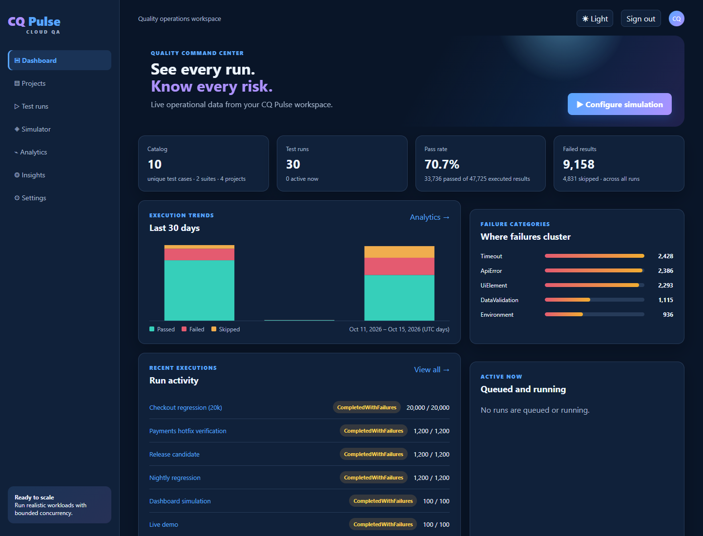
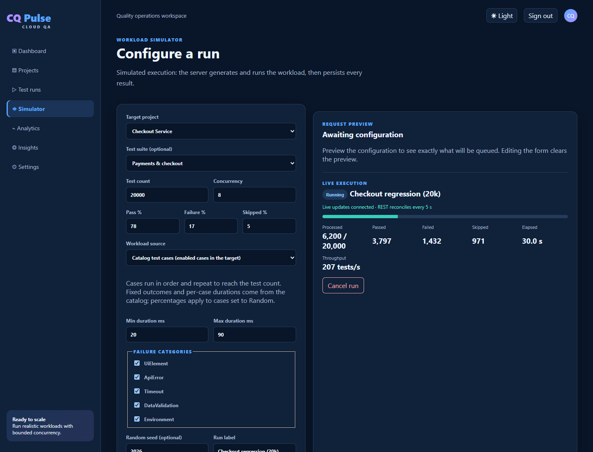
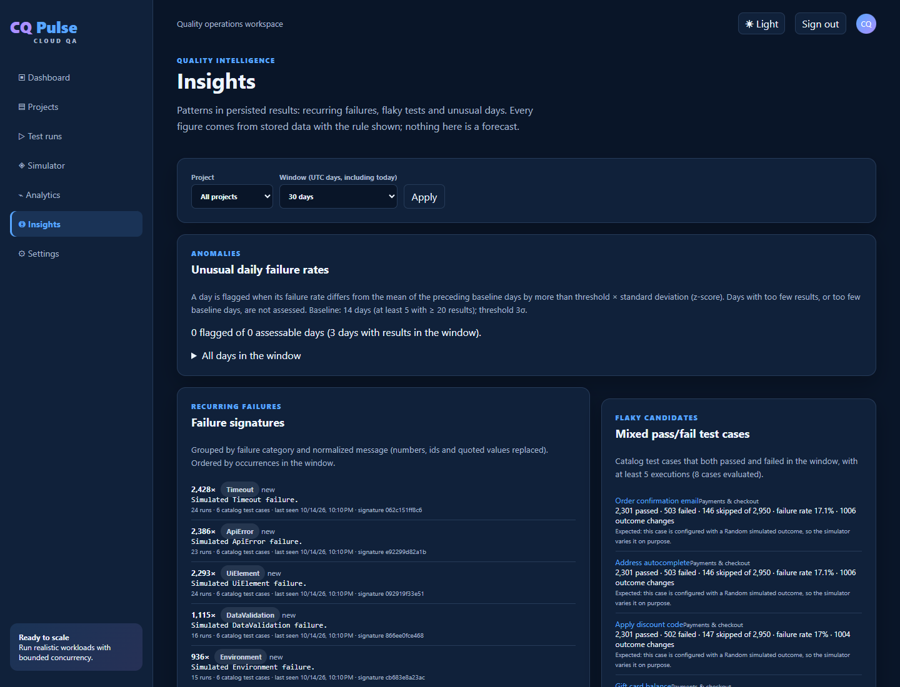
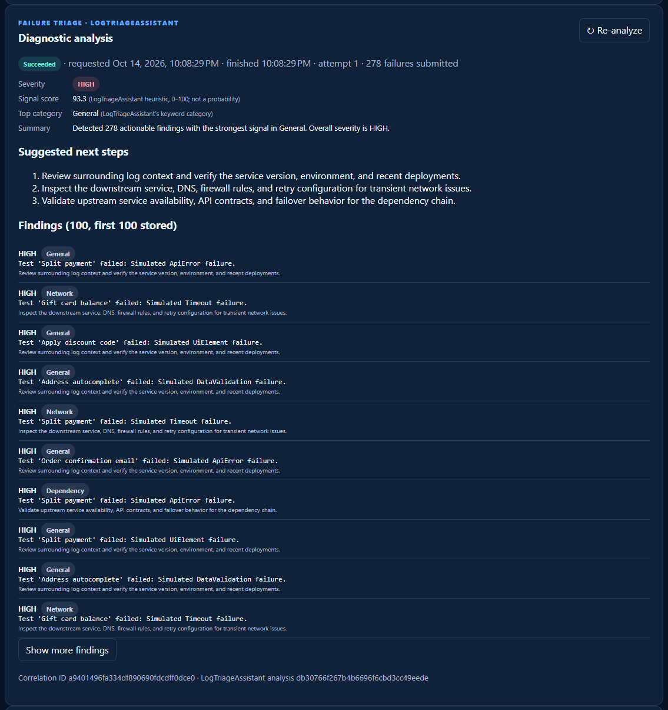
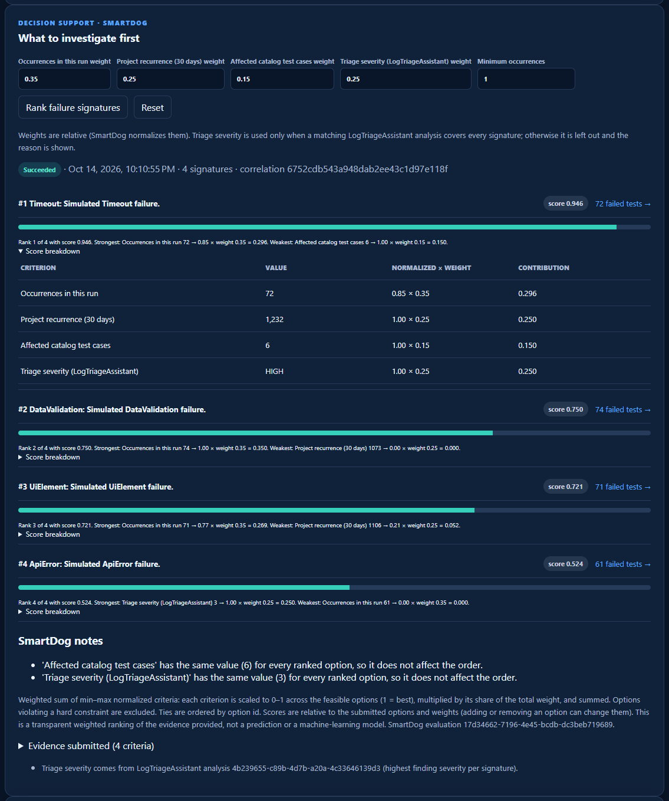
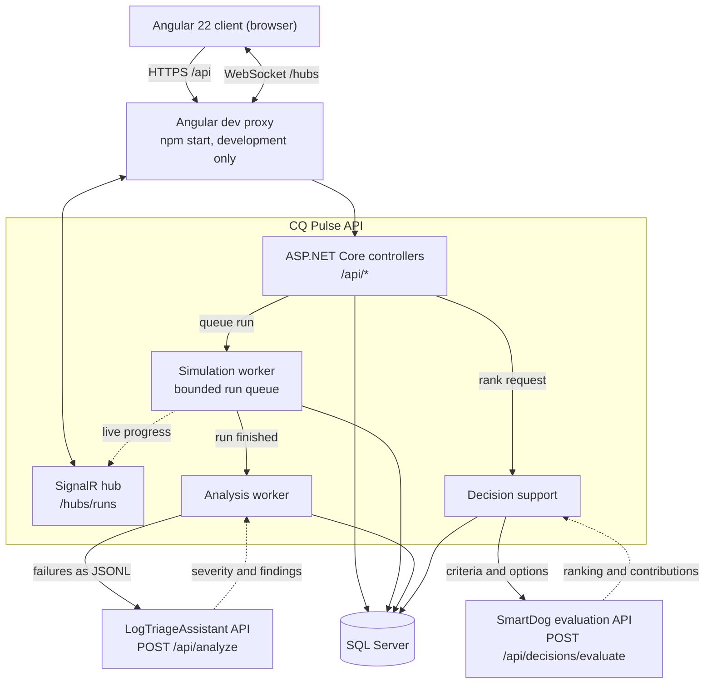

# CQ Pulse — Cloud QA

[](https://github.com/dipuks/cq-pulse/actions/workflows/ci.yml)

**CQ Pulse is a test management and quality-intelligence platform that runs deterministic, simulated test workloads, streams their progress live, and turns the results into explainable insights.**

.NET 10 · ASP.NET Core · EF Core · SQL Server · SignalR · Angular 22



> **Execution is simulated.** CQ Pulse does not launch browsers, test frameworks or external test workloads. Its server-side simulator generates seeded, reproducible results (up to 50,000 tests per run) so that persistence, live updates, analytics and integrations work at realistic scale.

## Features

- **Test catalog:** projects, suites and test cases with priorities, enable/disable, search and paging. Results keep a snapshot of the test name, so history survives edits and deletions.
- **Deterministic runs:** preview the exact pass/fail/skip totals before queueing; run catalog cases (fixed or random outcomes, per-case durations) or synthetic workloads. The same seed reproduces the same run; runs can be cancelled and rerun.
- **Live progress:** SignalR pushes progress to the browser, and REST polling remains the authoritative fallback.
- **Analytics and insights:** trends and failure categories over UTC windows; recurring failure signatures, flaky-test candidates and anomalous days, each shown with its rule and evidence. Nothing is forecast.
- **Failure triage (optional):** failed runs are analysed by [LogTriageAssistant](https://github.com/dipuks/LogTriageAssistant), which returns a severity, findings with redacted evidence, and next steps.
- **Decision support (optional):** SmartDog ranks a run's failure signatures to show what to investigate first, with a per-criterion breakdown of every score.
- **Resilient integrations:** if either service is down, CQ Pulse keeps working and records the outage with its reason instead of inventing results.

## Screenshots

All screenshots were captured from a local instance running simulated workloads.

<table>
  <tr>
    <td width="50%"><br><b>Live execution.</b> SignalR progress while a 20,000-test catalog run executes.</td>
    <td width="50%"><br><b>Quality insights.</b> Failure signatures, flaky candidates and anomaly rules, each with its evidence.</td>
  </tr>
  <tr>
    <td width="50%"><br><b>Failure triage.</b> LogTriageAssistant's severity, findings and suggested next steps for a run.</td>
    <td width="50%"><br><b>Decision support.</b> SmartDog's ranking with each score's per-criterion contributions.</td>
  </tr>
</table>

## Architecture



Solid arrows are requests and dotted arrows are responses or pushed updates. In development the Angular proxy gives the browser a single origin. In other setups the client is served from the API's host, or calls the API directly with CORS.

- **CQ Pulse** (this repository) orchestrates simulated test runs, stores every result, pushes live progress and computes analytics and insights.
- **LogTriageAssistant** analyses the failure log that CQ Pulse sends and returns severity, findings with redacted evidence, and next steps.
- **SmartDog** ranks options against weighted criteria and returns each score's per-criterion contributions. Its evaluation API is deterministic and uses no language model. That API is not yet published on GitHub.

The three services run as independent processes with their own storage, and communicate only through HTTPS APIs. CQ Pulse calls them with timeouts, bounded retries, a circuit breaker and correlation ids. More detail: [architecture](docs/architecture.md) and [integration design](docs/quality-intelligence-architecture.md).

## Quality and verification

- **Tests:** 91 unit tests and 122 integration tests against real SQL Server (each run uses a temporary database), plus 52 Angular tests. GitHub Actions runs them on every push to `main`.
- **Integrations:** contract-based test doubles cover outages, timeouts, rejected credentials and malformed responses. End-to-end, service-offline and browser checks against the real services are recorded in the [feature audit](docs/feature-audit.md).
- **Performance:** a 50,000-test run completes in about 17–19 s with a peak managed heap under 40 MB on a developer machine ([performance](docs/performance.md)).
- **Reliability:** bounded queues and channels with backpressure, batched persistence (run counters always equal stored rows), optimistic concurrency, one active run per target, and startup recovery.

## Getting started

### Prerequisites

- .NET 10 SDK and the EF Core tool (`dotnet tool install --global dotnet-ef`)
- Node.js 24+
- SQL Server Express or LocalDB
- A trusted HTTPS development certificate (`dotnet dev-certs https --trust`)

### Run CQ Pulse

Secrets live in user secrets or environment variables, never in `appsettings*.json` or source control. Use your own values:

```powershell
dotnet user-secrets set 'ConnectionStrings:CQPulse' 'Server=.\SQLEXPRESS;Database=CQPulse;Trusted_Connection=True;TrustServerCertificate=True;MultipleActiveResultSets=True' --project src\CQPulse.Api
dotnet user-secrets set 'Jwt:SigningKey' '<random key, at least 32 characters>' --project src\CQPulse.Api
dotnet user-secrets set 'DevelopmentAdmin:Email' 'you@example.test' --project src\CQPulse.Api
dotnet user-secrets set 'DevelopmentAdmin:Password' '<strong local password>' --project src\CQPulse.Api

dotnet ef database update --project src\CQPulse.Infrastructure --startup-project src\CQPulse.Api   # also after pulling new versions
dotnet run --project src\CQPulse.Api --launch-profile https                                       # https://localhost:7256
```

In a second terminal:

```powershell
Set-Location src\CQPulse.Client
npm install
npm start          # http://localhost:4200; proxies /api, /hubs (WebSockets) and /health to the API
```

Sign in with the development administrator, which is seeded only in the Development environment.

### Connect LogTriageAssistant (optional)

1. Start LogTriageAssistant over HTTPS (its session cookie is Secure-only): `dotnet run --launch-profile https` serves `https://localhost:7291`.
2. Register a dedicated account for CQ Pulse in LogTriageAssistant (its sign-up page or `POST /api/auth/register`).
3. Give CQ Pulse the URL and that account, then restart the API:

```powershell
dotnet user-secrets set 'Integrations:LogTriage:BaseUrl' 'https://localhost:7291' --project src\CQPulse.Api
dotnet user-secrets set 'Integrations:LogTriage:Username' '<service account>' --project src\CQPulse.Api
dotnet user-secrets set 'Integrations:LogTriage:Password' '<service account password>' --project src\CQPulse.Api
```

Runs that finish with failures are analysed automatically (`Integrations:LogTriage:AutoAnalyzeFailedRuns`, default `true`). Runs can also be analysed from **Run detail → Failure triage**. Failed or unavailable analyses can be retried without re-running the workload.

### Connect SmartDog (optional)

Generate one API key and configure it on both sides (this assumes the repositories are cloned side by side), then restart both:

```powershell
$key = [Convert]::ToBase64String([Security.Cryptography.RandomNumberGenerator]::GetBytes(32))
dotnet user-secrets set 'DecisionApi:ApiKeys:0' $key --project ..\SmartDog\SmartDog.Api
dotnet user-secrets set 'Integrations:SmartDog:BaseUrl' 'https://localhost:7018' --project src\CQPulse.Api
dotnet user-secrets set 'Integrations:SmartDog:ApiKey' $key --project src\CQPulse.Api
Remove-Variable key
```

**Run detail → Decision support** ranks the run's failure signatures by four criteria:

| Criterion | Default weight |
|---|---:|
| Occurrences in the run | 0.35 |
| 30-day project recurrence | 0.25 |
| Affected catalog test cases | 0.15 |
| LogTriageAssistant triage severity | 0.25 |

Weights can be adjusted per request. A criterion without trustworthy evidence is left out with the reason shown, never counted as zero. The evidence rules are in [integration design §6](docs/quality-intelligence-architecture.md#6-decision-support-evidence-rules).

### Start all three services

The recommended order is LogTriageAssistant, SmartDog, the CQ Pulse API, then the client, each in its own terminal from its own repository:

```powershell
dotnet run --launch-profile https                          # LogTriageAssistant → https://localhost:7291
dotnet run --project SmartDog.Api --launch-profile https   # SmartDog           → https://localhost:7018
dotnet run --project src\CQPulse.Api --launch-profile https   # CQ Pulse API    → https://localhost:7256
npm start                                                  # CQ Pulse client (src\CQPulse.Client) → http://localhost:4200
```

The order is a convenience, not a requirement. CQ Pulse checks the other services on demand, and **Settings → Connected services** shows each one as NotConfigured, Healthy or Unavailable with the reason. Services started later are picked up automatically; changed secrets need an API restart.

## Tests

```powershell
dotnet test CQPulse.slnx --filter "Category!=Performance"                    # 91 unit + 122 integration tests
dotnet test tests\CQPulse.IntegrationTests --filter "Category=Performance"   # opt-in workload measurements
Set-Location src\CQPulse.Client; npm test -- --watch=false; npm run build    # 52 client tests, production build
```

Integration tests host the real API in memory and create a temporary `CQPulse_Tests_<guid>` database per test collection. That database is dropped afterwards, and the development database is never touched. To use another SQL Server, set `CQPULSE_TEST_SQL` to a server-level connection string (no database name).

The other services have their own suites: `dotnet test SmartDog.slnx` in SmartDog (49 tests) and `dotnet test Tests` in LogTriageAssistant (108 tests, plus 5 Playwright end-to-end tests).

## Configuration reference

| Setting | Where | Purpose |
|---|---|---|
| `ConnectionStrings:CQPulse`, `Jwt:SigningKey` (≥ 32 chars) | user secrets / environment | Required to start the API |
| `DevelopmentAdmin:Email`, `DevelopmentAdmin:Password` | user secrets | Seeds an Administrator in the Development environment only |
| `Integrations:LogTriage:BaseUrl`, `Username`, `Password` | user secrets / environment | Optional failure triage |
| `Integrations:SmartDog:BaseUrl`, `ApiKey` | user secrets / environment | Optional decision support. `AttemptTimeoutSeconds` (10), `RetryCount` (2) and `RetryBaseDelayMilliseconds` (300) can also be set |
| `Integrations:LogTriage:MaxFailures` (500, the maximum), `QueueCapacity` (500), `PendingSweepSeconds` (15) | `appsettings.json` / environment | Severity sample size and the analysis queue ([operations](docs/operations.md#failure-analysis-queue)) |
| `Insights:SignatureBackfill:Enabled` (true), `BatchSize` (1,000), `PauseMilliseconds` (50) | `appsettings.json` / environment | Background signing of failures saved before `AddFailureSignatures` ([operations](docs/operations.md#backfill)) |
| `Simulator:*` | `appsettings.json` | Limits and tuning (max tests, concurrency, durations, queue, batch size) |
| `RateLimiting:Login:PermitLimit` / `WindowSeconds` | `appsettings.json` | Sign-in attempts per client IP (default 10 per 60 s) |
| `Cors:AllowedOrigins` | `appsettings.json` | Only needed when the client is served from another origin |
| `Logging:Console:IncludeScopes` | environment | `true` shows the `CorrelationId`, `RunId` and `AnalysisId` scopes in console logs |

Environment variables use `__` as the separator, for example `ConnectionStrings__CQPulse`.

## Troubleshooting

Start with **Settings → Connected services**, which checks each configured service live and shows the reason for any failure. Failed analyses and decision evaluations keep their error on **Run detail**.

| Symptom | Cause and fix |
|---|---|
| Sign-in page: *Cannot reach the CQ Pulse API* | The API is not running or not on `https://localhost:7256`. Start it first, then check `/health` (and `/health/ready` for the database). |
| API fails at startup naming `ConnectionStrings:CQPulse` or `Jwt:SigningKey` | Set both in user secrets (the signing key needs at least 32 characters). |
| *Invalid object name* errors after updating | Pending migrations: run the `dotnet ef database update` command above. |
| A service shows **NotConfigured** | Its `Integrations:*` settings are missing. Set them and restart the API. |
| *Unreachable: No connection could be made…* | The service is not running, or `BaseUrl` has the wrong host or port (LogTriageAssistant `https://localhost:7291`, SmartDog `https://localhost:7018`). |
| *Unreachable: timed out waiting for a response* | No answer within 5 seconds. On Windows a stopped localhost service can also appear this way, because refused connections are retried. |
| *The SSL connection could not be established* | Trust the development certificate (`dotnet dev-certs https --trust`) and restart the services. |
| Analysis **Failed**: *LogTriageAssistant rejected the configured service account credentials.* | The account does not exist in that LogTriageAssistant instance, or the credentials differ. Register it and update the secrets; use LogTriageAssistant's https profile. |
| Decision **Failed**: *SmartDog rejected the configured API key (401).* | CQ Pulse's `Integrations:SmartDog:ApiKey` does not match any SmartDog `DecisionApi:ApiKeys:N`. |
| Decision **Unavailable**: *SmartDog returned 503* while SmartDog shows Healthy | SmartDog has no `DecisionApi:ApiKeys` configured; its decision API fails closed until one is set. |
| Evidence note: *Triage severity was not used: …* | There is no successful analysis, or it was made from different failure data. Analyse or retry the run under **Failure triage**, then rank again. |
| Ranking refused (409): *… still waiting for the failure signature backfill* | Failed results saved before the `AddFailureSignatures` migration are still being signed. The API does it in the background; `dotnet run --project src\CQPulse.Api --launch-profile https -- backfill-signatures` does it in the foreground ([operations](docs/operations.md#stored-failure-signatures-migration-addfailuresignatures)). |
| Insights: *Signature counts are not final yet* | Same cause: those failures are in the total but in no signature until the backfill reaches them. |
| Failure triage: *Waiting for a free analysis slot* | More analyses are waiting than the queue holds (`QueueCapacity`); they are queued automatically, oldest first, as earlier ones finish. |

## Limitations

- Test execution is simulated; there is no real test runner.
- Run and analysis queues are in-process (one API instance), with startup recovery but no distributed workers.
- One global Administrator role; the JWT is kept in browser `localStorage` without refresh tokens.
- SmartDog's scores prioritize observed evidence; they are not predictions, and they are relative to the submitted signatures and weights.
- Ranking is limited to 25 failure signatures per run (the most frequent).
- Triage severity is based on at most 500 failed results per run, because LogTriageAssistant reports findings for at most 500 lines. Larger runs are sampled so that every signature is represented (most frequent first), and the evidence notes say how many results the severity reflects.
- Failures saved before the `AddFailureSignatures` migration count in insights and recurrence only after the signature backfill; until then insights say so, and ranking for affected projects is refused (409) rather than undercounted.
- SmartDog's separate chat workflow requires a local Ollama model and has not been verified; CQ Pulse uses only the structured evaluation API.

Verified results and remaining unverified items are listed in the [feature audit](docs/feature-audit.md).

## Documentation

- [Architecture](docs/architecture.md): layers, simulator pipeline, cross-cutting concerns
- [Integration design](docs/quality-intelligence-architecture.md): service contracts, reliability rules, decision-support evidence rules
- [Performance](docs/performance.md): measured 1k, 10k and 50k runs
- [Operations](docs/operations.md): the failure-signature migration and backfill (locking, rehearsal, recovery), the analysis queue and the severity sample
- [Feature audit](docs/feature-audit.md): current verification status, test results and the development log
- [Implementation plan](docs/implementation-plan.md): historical milestone plan
