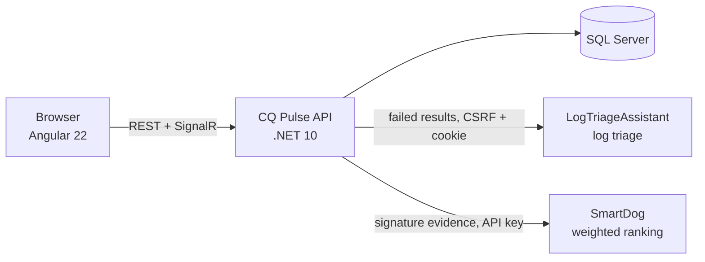

# CQ Pulse — Cloud QA

[](https://github.com/dipuks/cq-pulse/actions/workflows/ci.yml)

*See every run. Know every risk.*

CQ Pulse is a test management and quality intelligence platform built with .NET 10, Angular 22 and SQL Server. You organize projects, suites and test cases, run large workloads with live progress, and turn the persisted results into analytics and explainable insights. It shows which failures recur, which tests look flaky, which days are anomalous, and which failure to investigate first.

> **Execution is simulated.** CQ Pulse does not drive real browsers or test frameworks. Its simulator produces deterministic, reproducible workloads of up to 50,000 tests per run, so that persistence, real-time updates, analytics and integrations can be built and verified at realistic scale.

## What it does

1. **Organize:** projects → suites → test cases, with priorities, enable/disable, search, filters and paging. Every result keeps a snapshot of its test name, so execution history survives edits and deletions.
2. **Run:** preview the exact pass/fail/skip totals before queueing, then run real catalog cases (fixed or randomized outcomes, per-case durations) or a synthetic workload. Progress is live over SignalR, with REST polling as the authoritative fallback, and shows elapsed time and throughput. The same seed reproduces the same run; cancel and rerun are linked in the history.
3. **Analyze:** a dashboard, trends and failure categories over UTC-consistent windows. Run history has server-side filters, sorting and paging; run detail shows configuration, timing, every test result and the execution logs.
4. **Understand:** the Insights page groups failures into signatures (category + normalized message), finds flaky-test candidates and flags anomalous days against a statistical baseline. Every finding shows its rule and its evidence. Nothing is forecast.
5. **Triage (optional):** runs that finish with failures are sent to [LogTriageAssistant](https://github.com/dipuks/LogTriageAssistant). It returns a severity, categorized findings with redacted evidence, and suggested next steps.
6. **Decide (optional):** a separate SmartDog decision service ranks the run's failure signatures by occurrences, 30-day recurrence, affected test cases and triage severity. The ranking is a transparent weighted sum: every score comes with its per-criterion breakdown. Missing evidence is left out with the reason, never counted as zero.

## How the pieces fit



The three applications stay independent, with separate repositories, storage and UIs. CQ Pulse talks to the other two only over HTTP, with timeouts, bounded retries, a circuit breaker and correlation ids. If either service is down, CQ Pulse keeps working: it records the outage as *Unavailable* with the reason and never shows invented results. (The SmartDog evaluation API that CQ Pulse calls is not yet published on GitHub.)

## Engineering highlights

- **Correctness under load:** bounded queues and channels with backpressure, and batched persistence in which run counters always equal persisted rows. Also optimistic concurrency with `rowversion`, a filtered unique index that allows one active run per target, and startup recovery. Measured at 1k, 10k and 50k tests with a peak managed heap under 40 MB ([performance](docs/performance.md)).
- **Security:** ASP.NET Core Identity with JWT; the Administrator role guards every data endpoint and the SignalR hub. Lockout and per-IP sign-in rate limiting; secrets only in user secrets or environment variables.
- **API design:** RFC 7807 Problem Details with validation errors keyed by field, idempotent analysis requests (SHA-256 input digest), and correlation ids propagated to both services.
- **Tests:** 66 unit and 109 integration tests against real SQL Server, each run in a temporary database. Also 50 Angular tests, contract-based test doubles for both integrations, opt-in performance tests, and CI on GitHub Actions with a SQL Server service container. End-to-end, offline and browser verification against the real services is recorded in the [feature audit](docs/feature-audit.md).

## Tech stack

| Layer | Technology |
|---|---|
| API | .NET 10, ASP.NET Core, EF Core 10, ASP.NET Core Identity + JWT, SignalR, `Microsoft.Extensions.Http.Resilience` |
| Client | Angular 22 (standalone components, signals, lazy routes), Vitest |
| Data | SQL Server (Express or LocalDB locally, a container in CI) |
| Testing | xUnit, `WebApplicationFactory`, GitHub Actions |

Documentation: [architecture](docs/architecture.md) · [quality intelligence integration](docs/quality-intelligence-architecture.md) · [performance](docs/performance.md) · [feature audit](docs/feature-audit.md) · [implementation plan](docs/implementation-plan.md)

## Local prerequisites

- .NET SDK 10
- Node.js 24+
- SQL Server Express or SQL Server LocalDB

## Run locally

The local connection string is intentionally stored outside source control. For SQL Express:

```powershell
dotnet user-secrets set 'ConnectionStrings:CQPulse' 'Server=.\SQLEXPRESS;Database=CQPulse;Trusted_Connection=True;TrustServerCertificate=True;MultipleActiveResultSets=True' --project src\CQPulse.Api
dotnet user-secrets set 'Jwt:SigningKey' '<a-random-32-character-minimum-key>' --project src\CQPulse.Api
dotnet user-secrets set 'DevelopmentAdmin:Email' 'you@example.test' --project src\CQPulse.Api
dotnet user-secrets set 'DevelopmentAdmin:Password' '<a-strong-local-development-password>' --project src\CQPulse.Api
dotnet ef database update --project src\CQPulse.Infrastructure --startup-project src\CQPulse.Api
dotnet run --project src\CQPulse.Api --launch-profile https
```

In another terminal:

```powershell
Set-Location src\CQPulse.Client
npm install
npm start
```

Open `http://localhost:4200`. The API listens on `https://localhost:7256`; `npm start` proxies `/api`, `/hubs` (including SignalR WebSockets) and `/health` to it (`src/CQPulse.Client/proxy.conf.json`), so the browser talks to a single origin in development. Start the API first; if it is not running, the sign-in page reports that the API cannot be reached.

For other hosting setups, serve the client from the same host as the API, or set the `API_BASE_URL` injection token (`src/app/core/api-config.ts`) to the API origin and add the client origin to `Cors:AllowedOrigins`.

### Running all three applications

LogTriageAssistant and SmartDog are optional. CQ Pulse works without them and shows each one's state under **Settings → Connected services**. One-time configuration is described in [Failure triage](#failure-triage-with-logtriageassistant-optional) and [Decision support](#decision-support-with-smartdog-optional). Then start each in its own terminal:

```powershell
# 1. LogTriageAssistant (https://localhost:7291). HTTPS is required: its session cookie is Secure-only.
Set-Location C:\Projects\LogTriageAssistant
dotnet run --launch-profile https

# 2. SmartDog (https://localhost:7018). Needs DecisionApi:ApiKeys:0 in its user secrets.
Set-Location C:\Projects\SmartDog
dotnet run --project SmartDog.Api --launch-profile https

# 3. CQ Pulse API (https://localhost:7256), then the client (http://localhost:4200) in a fourth terminal
Set-Location C:\Projects\CQPulse
dotnet run --project src\CQPulse.Api --launch-profile https
Set-Location C:\Projects\CQPulse\src\CQPulse.Client
npm start
```

The start order only matters for convenience: CQ Pulse checks the other services on demand and records an outage as *Unavailable* with the reason.

## Verification

```powershell
dotnet test CQPulse.slnx --filter "Category!=Performance"                  # 66 unit + 109 integration tests
dotnet test tests\CQPulse.IntegrationTests --filter "Category=Performance"   # opt-in workload measurements (docs/performance.md)
Set-Location src\CQPulse.Client
npm run build
npm test -- --watch=false                                                  # 50 client tests
```

The integrations are tested against HTTP test doubles that follow each service's contract (`FakeLogTriageHandler`, `FakeSmartDogHandler`), including outages, timeouts, rejected credentials, validation errors and malformed responses. The end-to-end checks against the real services are recorded in [feature-audit.md](docs/feature-audit.md).

### Integration tests

`tests/CQPulse.IntegrationTests` hosts the real API in memory (`WebApplicationFactory`, environment `Testing`, so user secrets and development seeders are not loaded). Each test collection gets its own temporary database named `CQPulse_Tests_<guid>`, migrated on start and dropped on finish, including when tests fail. The development `CQPulse` database is never used: database management is restricted to names matching `CQPulse_Tests_<32 hex>`. Test databases left behind by a killed test run are removed on the next run once they are older than 6 hours.

By default the tests connect to `.\SQLEXPRESS` with Windows authentication. To use another server, set a **server-level** connection string (no database name):

```powershell
$env:CQPULSE_TEST_SQL = 'Server=localhost,1433;User Id=sa;Password=<password>;TrustServerCertificate=True'
```

Tests get users through `ApiFixture`: `CreateAdministratorClientAsync()`, `CreateClientAsync(fixture.NonAdministrator)` (authenticated, no role → 403 on data endpoints), and `CreateAnonymousClient()`. Each fixture creates its users with random passwords and signs them in through the real `/api/auth/login` endpoint.

## Configuration reference

| Setting | Where | Purpose |
|---|---|---|
| `ConnectionStrings:CQPulse`, `Jwt:SigningKey` (≥ 32 chars) | user secrets / environment | Required to start the API |
| `DevelopmentAdmin:Email`, `DevelopmentAdmin:Password` | user secrets | Seeds an Administrator in the Development environment only |
| `Simulator:*` | `appsettings.json` | Limits and tuning (max tests, concurrency, durations, queue, batch size) |
| `RateLimiting:Login:PermitLimit` / `WindowSeconds` | `appsettings.json` | Sign-in attempts per client IP (default 10 per 60 s) |
| `Cors:AllowedOrigins` | `appsettings.json` | Only needed when the client is served from another origin |
| `Integrations:LogTriage:*` | user secrets / environment | Optional failure triage (see below) |
| `Integrations:SmartDog:BaseUrl`, `ApiKey` | user secrets / environment | Optional decision support (see below). `AttemptTimeoutSeconds` (10), `RetryCount` (2) and `RetryBaseDelayMilliseconds` (300) can also be set |
| `Logging:Console:IncludeScopes` | environment / `appsettings.Development.json` | `true` shows the `CorrelationId`, `RunId` and `AnalysisId` scopes in console logs |

Environment variables use `__` as the separator, e.g. `ConnectionStrings__CQPulse`.

## Current limitations

- Execution is **simulated**; there is no real test runner.
- The run and analysis queues are in-process (one API instance). Restarts are handled by recovery (interrupted runs are marked failed; pending analyses are re-queued), but there is no distributed worker.
- One global Administrator role; no project-level membership or multi-tenant isolation.
- The JWT is stored in browser `localStorage` and there are no refresh tokens.
- Decision-support scores are relative to the submitted signatures and weights. They rank the evidence; they are not predictions. At most 25 signatures (the most frequent in the run) are ranked.
- Project recurrence is counted exactly in memory. If a project has more than 10,000 distinct failure messages in the last 30 days, ranking is refused (409) rather than undercounted.
- Triage severity reflects LogTriageAssistant's keyword analysis of at most 2,000 failures per run (the document limit). When a run has more, the evidence notes say so.
- Automatic analyses get their own correlation id: the id of the request that queued the run is not stored on the run. LogTriageAssistant receives the header but does not log it (it is used unchanged).

## Failure triage with LogTriageAssistant (optional)

CQ Pulse can send a run's persisted failures to a separately running [LogTriageAssistant](https://github.com/dipuks/LogTriageAssistant) for diagnostic analysis (severity, categorized findings with redacted evidence, suggested next steps). Nothing in LogTriageAssistant changes: CQ Pulse uses its existing API with a dedicated account.

1. Start LogTriageAssistant over HTTPS (its session cookie is Secure-only), e.g. its `https` profile on `https://localhost:7291`.
2. Register a dedicated account in LogTriageAssistant for CQ Pulse (sign-up page or `POST /api/auth/register`).
3. Configure CQ Pulse with user secrets (never in appsettings files):

```powershell
dotnet user-secrets set 'Integrations:LogTriage:BaseUrl' 'https://localhost:7291' --project src\CQPulse.Api
dotnet user-secrets set 'Integrations:LogTriage:Username' '<lta-service-account>' --project src\CQPulse.Api
dotnet user-secrets set 'Integrations:LogTriage:Password' '<lta-service-password>' --project src\CQPulse.Api
```

Runs that finish with failures are analysed automatically (`Integrations:LogTriage:AutoAnalyzeFailedRuns`, default `true`), or from **Run detail → Failure triage**. Analyses are asynchronous and never change a run. If the service is down, the analysis is recorded as *Unavailable* with the reason and can be retried without re-running the workload. **Settings → Connected services** shows whether each integration is configured and reachable.

## Decision support with SmartDog (optional)

**Run detail → Decision support** asks a separately running SmartDog decision service (its evaluation API is not yet published on GitHub) which of a finished run's failure signatures to investigate first. CQ Pulse uses SmartDog's structured `POST /api/decisions/evaluate` endpoint, which is deterministic and uses no language model or machine learning. The contract is documented in SmartDog's README.

1. Give SmartDog an API key and CQ Pulse the same key (user secrets on both sides, never in appsettings files):

```powershell
$key = [Convert]::ToBase64String([Security.Cryptography.RandomNumberGenerator]::GetBytes(32))
dotnet user-secrets set 'DecisionApi:ApiKeys:0' $key --project C:\Projects\SmartDog\SmartDog.Api
dotnet user-secrets set 'Integrations:SmartDog:BaseUrl' 'https://localhost:7018' --project src\CQPulse.Api
dotnet user-secrets set 'Integrations:SmartDog:ApiKey' $key --project src\CQPulse.Api
Remove-Variable key
```

2. Start SmartDog (`dotnet run --project SmartDog.Api --launch-profile https`) and restart the CQ Pulse API.

**Evidence.** Each failure signature in the run is one option. A signature is the failure category plus the normalized message, as on the Insights page.

| Criterion | Default weight | Source |
|---|---:|---|
| Occurrences in this run | 0.35 | Failed results in the run with this signature (exact) |
| Project recurrence (30 days) | 0.25 | Failed results with this signature in the project over the last 30 UTC days, this run included (exact; 0 when there are none) |
| Affected catalog test cases | 0.15 | Distinct catalog test cases in the run that failed with this signature (0 for synthetic workloads) |
| Triage severity | 0.25 | Highest LogTriageAssistant finding severity on the signature's lines (INFO 1, MEDIUM 2, HIGH 3, CRITICAL 4) |

Triage severity is used only if the run's latest successful analysis was made from exactly the run's current failure data and covers every ranked signature. Otherwise the criterion is left out for all options and the reason is shown. Weights can be changed per request (relative values, > 0 and ≤ 1000), and *minimum occurrences* is sent as a hard constraint.

The panel shows the ranking and each score's per-criterion breakdown (value, normalized value × weight, contribution). It also shows SmartDog's notes, method and limitations, the evidence submitted, and the evaluation history. Each signature links to its failed results. Every request is stored with its evidence, correlation id and outcome. If SmartDog is down, misconfigured or rejects the request, the evaluation is recorded as *Unavailable* or *Failed* with the reason and **no ranking is shown**; the rest of CQ Pulse is unaffected.
