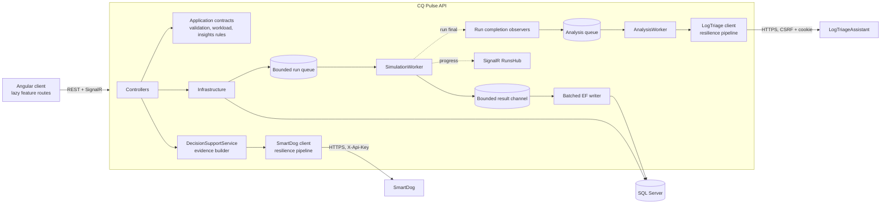

# Architecture

CQ Pulse is a layered .NET 10 API with an Angular 22 client and SQL Server. It integrates optionally with LogTriageAssistant and SmartDog, which run as separate services and are called over HTTPS.

Related: [README](../README.md) (overview, setup, troubleshooting) · [integration design](quality-intelligence-architecture.md) · [performance](performance.md) · [feature audit](feature-audit.md) (verification status)

The diagram below shows the API's internal components. The system-level view of all three services is in the [README](../README.md#architecture).

## Layers

| Project | Responsibility |
|---|---|
| `CQPulse.Domain` | Entities and state machines: `TestRun` (Queued → Running → Passed / CompletedWithFailures / Failed / Cancelled), `FailureAnalysis` (Pending → Running → Succeeded / Failed / Unavailable), `DecisionEvaluation` (Succeeded / Failed / Unavailable, with request, evidence and result) |
| `CQPulse.Application` | DTOs and service contracts, `SimulationRequestValidator`, `SimulationWorkload` (deterministic workload generation), `FailureSignature`, `InsightCalculator`, decision criteria and severity scale, typed exceptions |
| `CQPulse.Infrastructure` | EF Core persistence and migrations, Identity, catalog service, simulator (queue, worker, writer, recovery), LogTriageAssistant and SmartDog integrations, integration status |
| `CQPulse.Api` | Controllers, JWT auth, Problem Details mapping, correlation middleware, SignalR hub, health checks, rate limiting |
| `CQPulse.Client` | Angular standalone components: `core/` (API, auth, models), `shared/` (state, pager, chart), `layout/`, `features/*` (lazy) |

## Simulator pipeline

1. `POST /api/simulator/runs` validates the request against configurable `Simulator` limits, rejects a second active run for the same target (pre-check plus filtered unique index), stores the configuration snapshot and enqueues the run id (bounded channel; callers wait when full).
2. `SimulationWorker` executes one run at a time. `SimulationWorkload` generates each test on demand: synthetic tests, or enabled catalog test cases cycled to the test count. Outcomes are allocated exactly by percentage and assigned through a seeded permutation, so the same seed reproduces the same run in any process. Tests run with `Parallel.ForEachAsync` bounded by the requested concurrency.
3. Results go through a bounded channel (backpressure) to a writer that saves batches of 500 with a short-lived `DbContext`. In the same transaction it increments the run's counters and writes a log entry per failed test, so counters always equal persisted rows and REST polling sees live progress.
4. The worker decides the terminal state from freshly loaded data with a `rowversion` check, so an accepted cancellation is never overwritten. Execution or persistence failures mark the run `Failed`, and a failing writer cancels producers instead of deadlocking. Progress is pushed through SignalR (best effort) and polled through REST (authoritative).
5. Startup recovery marks runs left queued or running by a restart as `Failed`.

Measured behaviour: [performance.md](performance.md).

## Cross-cutting

- **Errors:** application exceptions map to RFC 7807 Problem Details (400 with field errors / 404 / 409); unexpected errors return a generic 500.
- **Security:** JWT bearer (Administrator role on every data endpoint and the hub), Identity lockout, per-IP sign-in rate limit, CORS limited to configured origins. Secrets come only from user secrets or environment variables.
- **Observability:** `X-Correlation-ID` per request (accepted or generated, echoed, in the log scope, stored on analyses and decision evaluations, forwarded to integrations). Logs carry run, analysis and correlation ids as message-template scopes, visible in console output with `Logging:Console:IncludeScopes=true`. `/health` (liveness) and `/health/ready` (database). Optional integrations are reported separately at `/api/integrations/status`.
- **Live progress:** SignalR messages count executed tests, while REST returns persisted counters (written in batches of 500). The simulator page keeps the newer live value when a REST snapshot lags, so progress never moves backwards; a terminal snapshot is authoritative.
- **Time:** all timestamps are stored as UTC `DateTimeOffset`. Filters use half-open UTC ranges `[fromUtc, toUtc)`, and daily aggregates use UTC calendar days.

## Testing

| Suite | Scope |
|---|---|
| `tests/CQPulse.UnitTests` (91) | `TestRun` state machine, synthetic and catalog workload generation with exact allocation, request validation, insight rules and failure-signature normalization (rules and known hashes pinned) |
| `tests/CQPulse.IntegrationTests` (122) | The real API hosted in memory (`WebApplicationFactory`, environment `Testing`, so no user secrets or development seeders) against SQL Server |
| `src/CQPulse.Client` (52, Vitest) | Authentication guard and interceptor, error and date handling, the analytics, insights, simulator and run-detail pages, triage and decision panels, and the trend chart |

- **Databases:** each integration test collection creates a temporary `CQPulse_Tests_<guid>` database, migrates it and drops it afterwards, even when tests fail. Database management only accepts names matching `^CQPulse_Tests_[0-9a-f]{32}$`, so the development database is never touched. Orphans from killed runs are removed once they are more than 6 hours old. Set `CQPULSE_TEST_SQL` to a server-level connection string (no database name) to use another server; CI uses a SQL Server container this way.
- **Users:** `ApiFixture` creates an Administrator and an authenticated user without a role, both with random passwords, and signs them in through the real `/api/auth/login` endpoint.
- **Integrations:** `FakeLogTriageHandler` and `FakeSmartDogHandler` implement each service's HTTP contract and can simulate outages, timeouts, rejected credentials, validation errors and malformed responses.
- **Performance:** `PerformanceTests` (`Category=Performance`) is opt-in and excluded from the default run ([performance.md](performance.md)).

## Known limits

- The run and analysis queues are in-process. Queued work survives restarts only as database state (runs are failed by recovery; pending analyses are re-queued), and there is no multi-instance worker coordination.
- Single global Administrator role; no project-level membership or tenant isolation.
- The JWT is kept in browser `localStorage` (no refresh tokens).
- Decision support ranks at most 25 signatures with scores that prioritize observed evidence (not predictions), and triage severity comes from a sample of at most 500 failures per run (the most lines LogTriageAssistant reports findings for), taken across signatures. SmartDog's chat workflow (Ollama) is not used or verified. Details and integration troubleshooting: [quality-intelligence-architecture.md](quality-intelligence-architecture.md#9-operations-and-limitations) and the [README](../README.md#troubleshooting).
